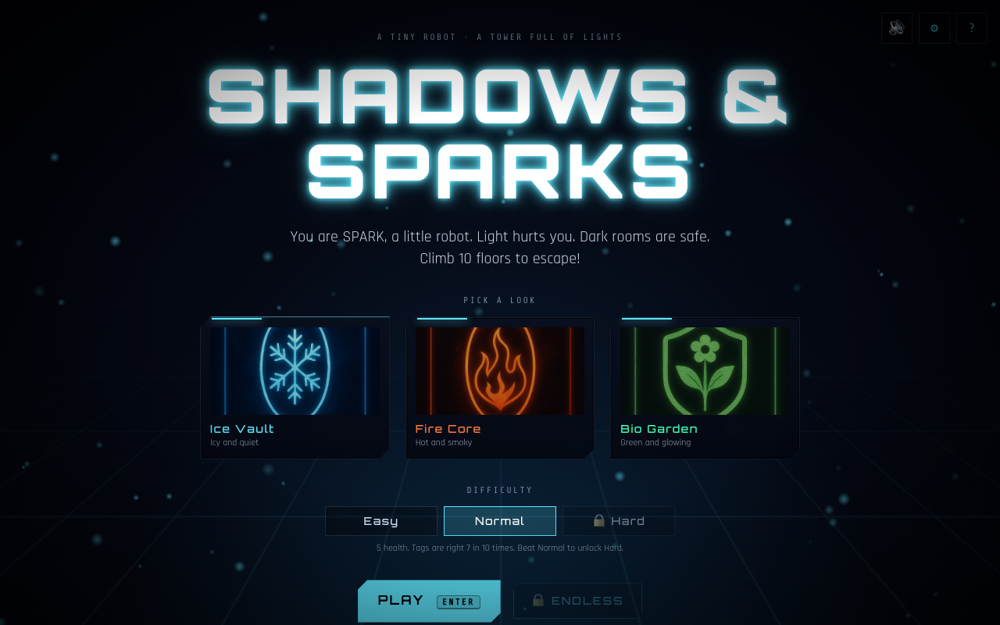
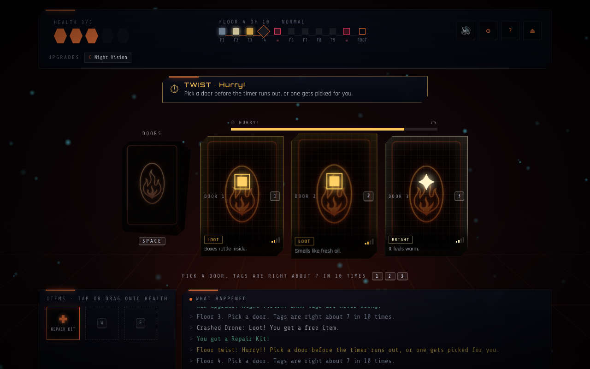
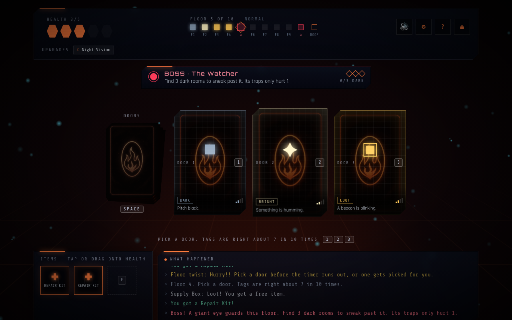
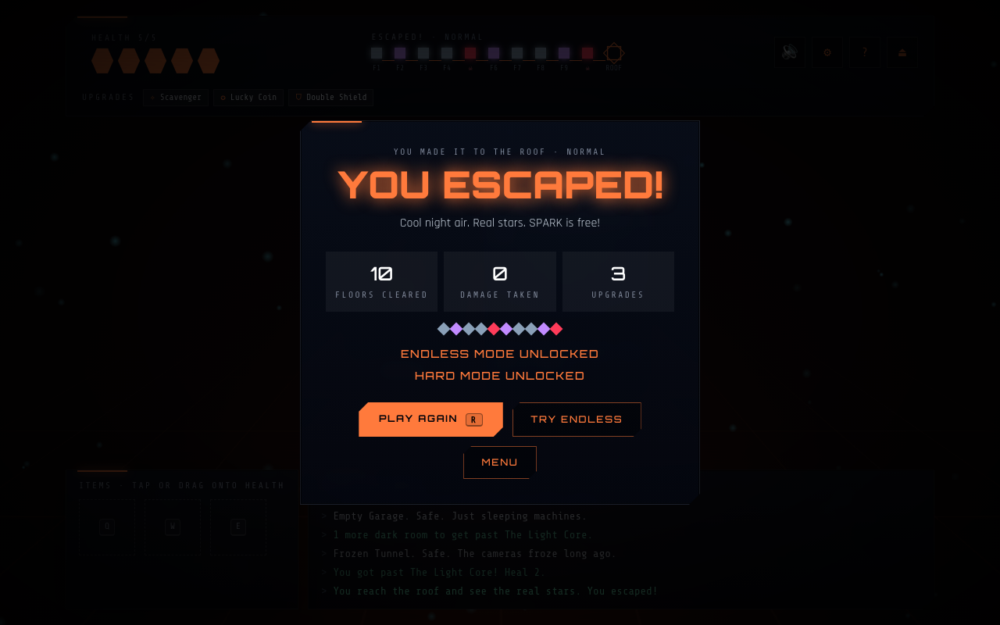
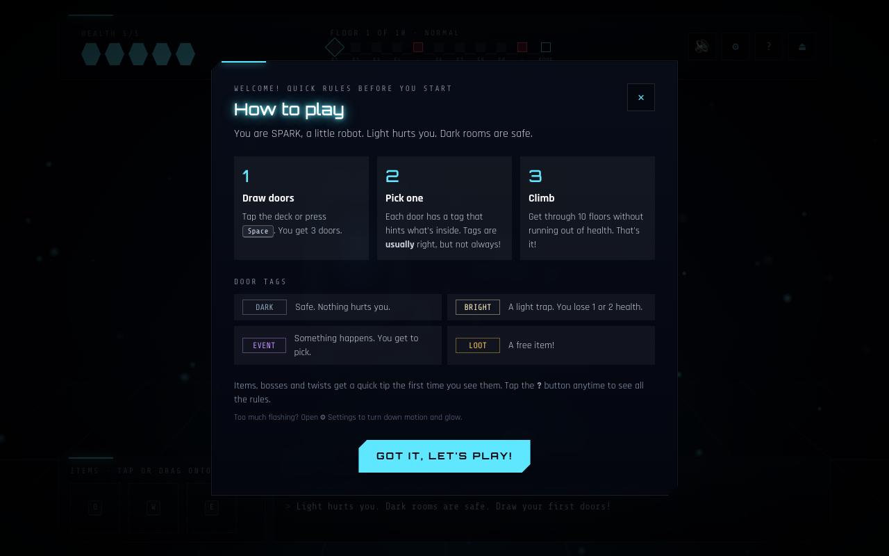
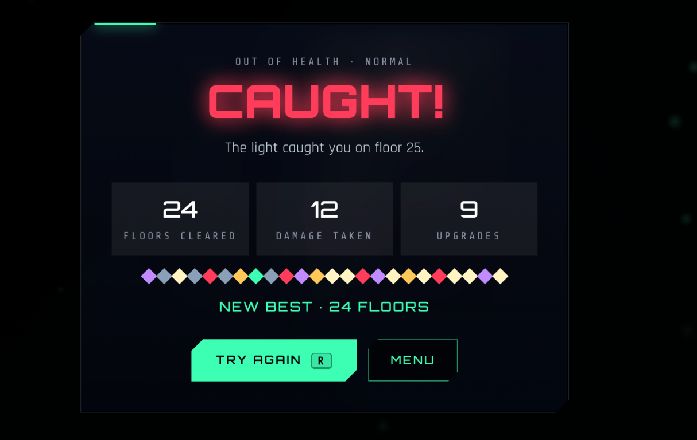

# Shadows & Sparks

### ▶️ [Play it now](https://harikayedidi.github.io/Shadows-Sparks/)

A quick sci-fi card game about a tiny robot escaping a tower full of lights. **Light hurts you. Dark rooms are safe.**

Pick a door, hope the tag isn't lying, and climb 10 floors. Along the way you grab items, pick upgrades that last the whole run, sneak past bosses, and deal with floors that change the rules. A run takes about 3 to 5 minutes, and no two play the same. Inspired by roguelikes like *Slay the Spire* and *Balatro*.

Pick **Easy**, **Normal** or **Hard**. Works on desktop and phone, with full keyboard play and settings to turn motion and glow down or off. New players get a quick how-to-play popup on their first run.

## 📸 Screenshots

| Pick a look and a difficulty | Pick a door |
| --- | --- |
|  |  |
| **Sneak past a boss** | **Escape the tower** |
|  |  |
| **First time? Quick rules** | **Endless: go as far as you can** |
|  |  |

---

## 🚀 Project Summary

This project explores how far **AI-assisted development** can go when building a complete game end-to-end inside VS Code.

- **Version 1** was the original: a solo card game about light and dark, with animated cards, sound and a mobile-first layout.
- **Version 2** turns it into a real run-based game: a futuristic look, upgrades, boss floors, floor twists, first-time tips, simple instructions, difficulty levels, comfort settings, and hosting on GitHub Pages.

Built with **React**, **Tailwind CSS** and **Framer Motion**. Card backs were generated with **ChatGPT 4o image generation**.

---

## 🎮 How to play

You are **SPARK**, a little robot escaping a tower full of lights. **Light hurts you. Dark rooms are safe.**

1. **Draw doors.** Tap the deck or press `Space`. You get 3 doors.
2. **Pick one.** Each door has a tag that hints at what's inside. Tags are *usually* right (about 7 in 10 times).
3. **Climb.** Get through 10 floors without running out of health. Win once to unlock **Endless**.

| Tag | What it usually means |
| --- | --- |
| DARK | Safe. Nothing hurts you. |
| BRIGHT | A light trap. Lose 1 or 2 health. |
| EVENT | Something happens and you pick what to do. |
| LOOT | A free item. |

### Items

| Item | What it does |
| --- | --- |
| Shadow Cloak | Heal 1 and skip this floor |
| Shield | Blocks the next bright trap |
| X-Ray | Shows what is behind every door |
| Repair Kit | Heal 1 |
| Reroll | Swap the doors for new ones |

Tap an item to use it, or **drag it onto your health**.

### Upgrades, bosses and twists

- **Upgrades:** after floors 2, 5 and 7 you pick 1 of 3 upgrades that last the whole run (Night Vision, Sunglasses, Lucky Coin, Extra Door, Spare Battery and more). Some combo well together.
- **Bosses:** floors 5 and 10 have a boss. You stay on the floor until you find enough dark rooms to sneak past.
- **Twists:** some floors get a special rule, like *Lights Out* (no tags), *Hurry!* (a timer), *Upside Down* (DARK and BRIGHT swapped) or *Lucky Floor* (marked free loot).

### Difficulty

| | Easy | Normal | Hard |
| --- | --- | --- | --- |
| Health | 6 | 5 | 4 |
| Tags are right | 8 in 10 | 7 in 10 | 6 in 10 |
| Big traps and twists | fewer | some | more |
| *Hurry!* timer | 12s | 8s | 5s |
| Boss needs | 1 fewer dark room | as listed | 1 more dark room |

Beat Normal (or Hard) once to unlock Hard. Difficulty applies to Endless too, and your best is saved for each one.

### Controls

| Action | Mouse / touch | Keyboard |
| --- | --- | --- |
| Draw doors | Tap or drag the deck | `Space` / `Enter` |
| Pick a door | Tap it or drag it up | `1`–`4` |
| Pick an event option or upgrade | Tap it | `1` `2` `3` |
| Use an item | Tap it or drag onto health | `Q` `W` `E` `R` |
| Sound / help | Top-right icons | `M` / `H` |
| Play again | Panel button | `R` |

### Comfort settings

Open **⚙ Settings** to change:

- **Motion:** Full, Reduced (no shaking, tilting or looping effects) or Off (no animation at all). Defaults to Reduced if your device asks for less motion.
- **Glow:** turn the neon glow off for a flat, calm look.
- **Sound**, and a button to show the beginner tips again.

---

## 🌌 Looks

Pick a look on the title screen. Each one has its own colors, particles, card back and ambient music:

- **Ice Vault**: icy and quiet
- **Fire Core**: hot and smoky
- **Bio Garden**: green and glowing

---

## ✨ Features

- 🧭 Real choices: doors with tags that can lie, items, risky events, and run-long upgrades
- 👾 Boss floors and random floor twists so no two runs play the same
- 💡 Short first-time tips instead of a wall of rules
- 🃏 Tactile cards: 3D tilt, flip reveals, and drag-to-act on the deck, doors and items
- 🗺️ A floor map showing your route and the boss floors ahead
- 🔊 Ambient audio that gets tenser as your health drops, plus haptics on supported phones
- ♿ Full keyboard play, ARIA labels, and Motion/Glow settings
- 🎚️ Easy, Normal and Hard difficulty
- 💾 Remembers your look, settings, difficulty, unlocks and best runs

---

## 🧠 AI Workflow

**Version 1** was built with **Roo Code Agent**, **GitHub Copilot**, **Claude 3.5 Sonnet** and **ChatGPT/GPT-4o**. Big tasks were broken into small prompts, then iterated over dozens of turns.

**Version 2** was built with **GitHub Copilot in VS Code**:

- Rewrote the rules as a pure, seeded game engine so they're easy to test and balance
- Ran lots of simulated games to tune each difficulty (on Normal, following the tags wins about 7 in 10 runs)
- Played the game in a real browser on desktop and phone sizes to catch layout and accessibility issues

---

## ⚙️ Tech Stack

- **Frontend**: React  
- **Styling**: Tailwind CSS  
- **Animations**: motion.dev (Framer Motion)  
- **Build and hosting**: Vite, GitHub Pages  
- **AI Tooling**: GitHub Copilot, Roo Code Agent, Claude, ChatGPT 4o  

---

## 🤝 Want to help?

Ideas, bug reports and code are all welcome!

- **Found a bug or have an idea?** [Open an issue](https://github.com/harikayedidi/Shadows-Sparks/issues/new/choose). New cards, upgrades, twists, bosses and looks are great places to start.
- **Want to build it?** Fork the repo, make your change, and open a pull request. Small PRs are easiest to review.

To run it locally: `npm install`, then `npm run dev`.

**Where things live:**

- `src/game/engine.js`: pure, seeded game reducer (all rules live here)
- `src/data/`: rooms, items, upgrades, twists, bosses, difficulties and looks
- `src/hooks/`: React wiring (game loop, effects, settings, tips, keyboard, tilt)
- `src/components/`: UI components
- `src/utils/audio.js`: Web Audio engine (samples, synth blips, ambient drone)

---

## 🧪 What’s Next

- A daily run with the same seed for everyone
- A shop between floors and more upgrades that combo

---

## 📜 License

This project is open-source and free to use. Attribution appreciated but not required.
